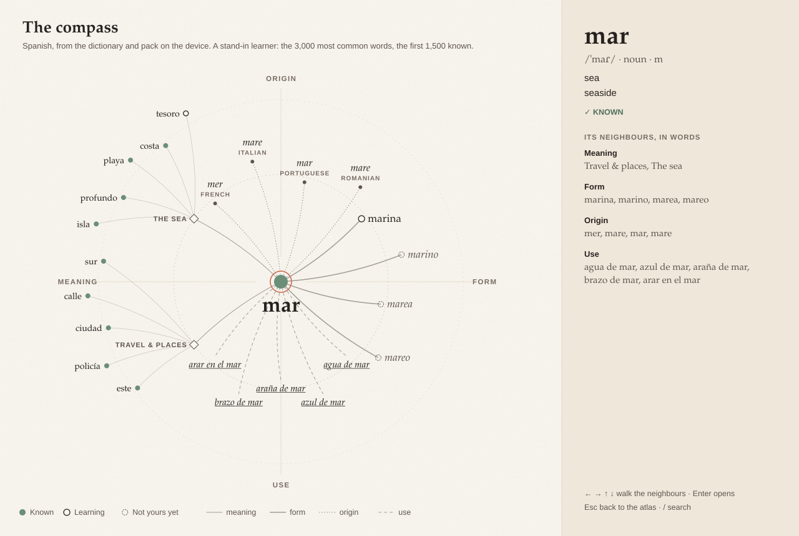
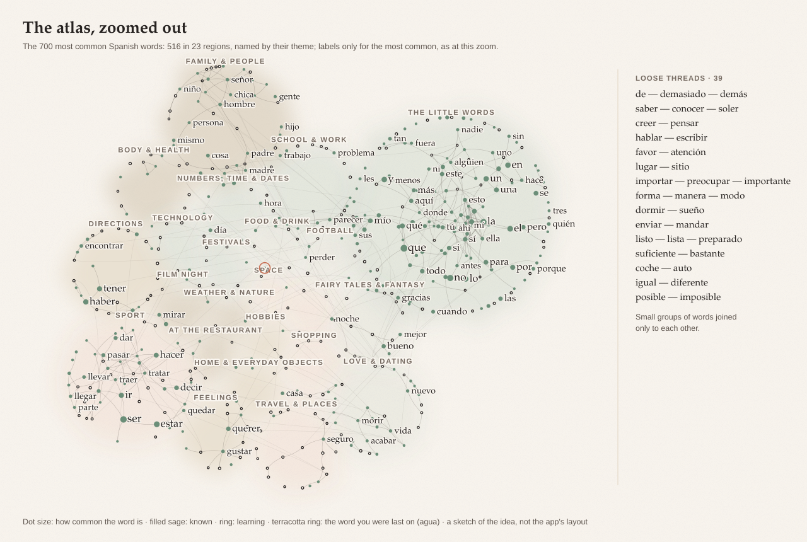

# The word graph · the plan (Lingua 6, step 6-29)

**Status: planned 2026-10-29, nothing built.** Planned by Claude Opus from the real dictionary and pack files; to be built
by Opus (the user's word) in seven pushes, **G1 to G7**, each versioned on its own. Claim the step in
[LINGUA-6-PLAN.md](LINGUA-6-PLAN.md)'s table (row 6-29) before the first push, as every step is claimed.

**The user, 2026-10-29:** "In Thesaurus I was thinking of a graph view, like a beautiful, bookish, aesthetic web view,
where you have an overview of your personal vocabulary and dictionary, like a second brain, kind of like Obsidian, but
made for and specialised completely for languages." And, the same day, while this plan was being written: "make sure in
the plan is a clear plan to make all connections, lines, smooth, dynamic, aesthetic", and "everything should be easy to
overview, hover, scroll, zoom, see, all the words you know, easy to use and see". Sections 3 and 4 are those two messages.

**Read first:** [CLAUDE.md](../CLAUDE.md); Part One of [the handbook](handbook/Lingua-Design-Handbook.pdf) and its chapters
*Thesaurus and Ludus*, *How it feels*, *Dark, and the papers*, *Charts and numbers* and *Accessibility*;
[PERFORMANCE.md](PERFORMANCE.md); [LINGUA-6-CONTRACTS.md](LINGUA-6-CONTRACTS.md).



*The compass of* mar, *drawn by a script from the Spanish dictionary and pack in `public/`, for a stand-in learner (the
3,000 most common words, the first 1,500 known). Its two themes to the west with their other words, its family to the east
(three of them not yours yet), the same word in four languages to the north, set phrases to the south; the word's page
beside it, ending in its neighbours as a list.*



*The atlas zoomed out: the 700 most common Spanish words, 516 of them in 23 regions, the little words a continent of their
own, 39 loose threads in the margin; threads curved inside regions and bundled between them. A plain layout in a script,
not the app's: it shows the idea and the real data's shape.*

---

## 0. In one page

Your words as the map in a good book. Every word you have is a place; the threads between them are what the language
says about them (same meaning, same family, same origin, used together) and what you did with them (where you met them,
what you mixed up, what you linked yourself). You can stand back and see all of it at once, in regions named by what
they're about, or stand on one word and see everything around it. How well you know a word is in its ink, so fading words
fade. And each view ends in something to do, so the map is a way into practice, not a poster.

**The seven calls.**

1. **Two views of one web.** *The atlas* shows every word you have at once, in regions, and is where the tab opens: the
   user's overview. *The compass* shows one word with its neighbours in four quarters (meaning, form, origin, use), and is
   where a word opens: from its page, the reader, a search or the atlas. The handbook's rule for the map ("the map starts
   from one word, never the whole graph") still holds when you come from a word; G7 rewrites its row for the tab.
2. **Hubs only when small.** A shared thing (a theme, an affix, a character, a root, a deck, a text) is one node its words
   hang from, so a 50-word theme is 50 threads, not 1,225. Only groups of **2 to 60** of your words are hubs; bigger ones (a
   part of speech, a gender, a 400-word book, an ending like *-ar*) are **lenses**: a filter or a tint, never a star of lines.
3. **Size is how common, ink is how well.** A dot's size comes from the word's frequency rank, which never changes (a
   town's size on a map), so the map doesn't redraw itself daily. Its ink is how well you know it: filled sage for known,
   an ink ring for learning, and fading as its cards say you're forgetting.
4. **Lines drawn like ink.** Curves with one hand's bend, hairline, bundled between regions, never through a label;
   alive when you act (they draw themselves out when a word opens, follow what you drag), still when you read.
5. **Everything easy to see.** At "fit all" every word you have is a visible dot; zooming brings labels in smoothly; hover,
   scroll, pinch and drag work as on a good map; a minimap and search are always a key away.
6. **Every view ends in something to do.** Fading here: review them. Loose threads: link or learn. Words to discover: the
   inbox. Your mix-ups: practise telling them apart. The handbook asks "Does the word map help, or is it only
   beautiful?" (*The check*); section 7 is the answer.
7. **Each language brings its own threads.** Characters in Chinese and Japanese, aspect pairs and prefixes in Russian,
   compounds and prefixes in German, roots in Arabic, cognates across the Romance languages (section 5).

| Push | What the learner gets | Size |
| --- | --- | --- |
| **G1** The model | Nothing on screen: the web built and tested on real-shaped data | M |
| **G2** The compass | The new tab; one word and its neighbours, the smooth lines, hover and zoom, the word's page beside it; "See its neighbours" on every word's page | L |
| **G3** The contract | Nothing on screen: Dexie 46 for the cached layout and saved views; the fields and question the later pushes need | S |
| **G4** The atlas | All your words at once: regions, landmarks, semantic zoom, bundled lines, the minimap, search that flies | L |
| **G5** Tools | Lenses and filters, saved views, your own links and pins, clusters, the lists that lead to practice | L |
| **G6** Time and bridges | How your web grew (a slider and a replay); your other languages joined by cognates | M |
| **G7** The finish and the check | The bookish finish, dark and the palettes, reduced motion, the screen reader, the performance check, the handbook's page | M |

It needs Part A only (done), so it runs beside Part B. The compass ships first because it needs no worker, no table and no
new dependency, and every later push draws with its renderer.

---

## 1. What the data holds (measured 2026-10-29)

Measured on the files every device downloads: the full dictionaries (`public/dict/<lang>.v3.json.gz`, 6-1b) and the
language packs (`public/packs/<lang>.v8.json.gz`, with their themed lists). **A stand-in learner** has the N most common
words by the dictionary's rank `r`. No real learner's data was used, so these are shapes, not promises (habit IV).

| The 3,000 most common words | Spanish | German | Russian |
| --- | --- | --- | --- |
| Word-to-word threads (the atlas's families) | **3,136** | **3,052** | **3,463** |
| … synonyms | 1,432 | 1,155 | 923 |
| … family (`related`, `derived`, `parts`) | 1,404 | 1,599 | 2,174 |
| … antonyms | 186 | 184 | 107 |
| … gender and aspect pairs | 98 | 91 | 248 |
| … homophones | 16 | 23 | 11 |
| Theme hubs (the pack's lists) | 38, joining 1,018 words | 38, joining 947 | 38, joining 931 |
| Affix hubs (2 to 60 words) | 45, joining 311 | 79, joining 725 | 119, joining 973 |
| Shared-ancestor hubs (`root`) | 13, joining 27 | 17, joining 35 | 15, joining 30 |
| Words with no thread and no hub | 478 | 526 | 410 |

So a 3,000-word web is about 3,100 dots and 4,500 threads: light for a canvas. At 10,000 Spanish words it is 11,286
word-to-word threads plus hubs. **What the numbers changed:**

- **Set phrases belong to the compass, never the atlas.** Joined everywhere, Spanish phrases would add 8,588 hubs and
  22,823 threads to 3,000 words: three times the rest of the web. In the compass they are the Use quarter, the ones made of
  your words first.
- **Look-alikes (`c`, "easily confused") are a switch in the compass.** 1,258 threads among 3,000 Spanish words, mostly
  spelling neighbours (*hacer*: *haber*, *hace*, *nacer*, *acero*). Off by default, under Form.
- **`root` is not a family.** It is the word's ancestor in another language (*hacer* ← Old Spanish *fazer*), so it joins
  only 13 pairs among 3,000 Spanish words. Families come from `parts`, `derived` and `related`. `root` shows in the Origin
  quarter (only when it differs from the word: *mar* ← Old Spanish *mar* says nothing), and is a hub only when two of your
  words share it.
- **Endings that only make a part of speech are lenses.** The biggest affix "hubs" are grammar, not meaning: Spanish
  *-ar* (71 of 3,000 words) and *-mente* (47), Russian *-ся* (160) and *-о* (145), German *-en* (55). A short list per
  language turns them into lenses ("adverbs in -mente"); affixes that change the meaning stay hubs: *des-*, *re-*, *-ción*,
  *-dor*; *ver-*, *be-*, *-ung*, *-lich*; *по-*, *за-*, *на-*.
- **Pairs are threads only for gender and aspect.** 1,994 of the 2,831 pairs listed on the 3,000 Spanish words are plurals,
  which are forms of the same word. Feminine and masculine (*perro* · *perra*) and Russian's aspect pairs (477 imperfective and 360
  perfective labels among 3,000 words) are threads.
- **Join on the app's own key.** With raw strings Russian has 644 threads among 3,000 words; with its stress marks folded,
  3,463: four threads in five were lost. The model joins through `normalizeWord(word, lang)` (`core/text/normalize.ts`), which
  folds Russian stress and Arabic vowel marks and keeps Spanish *sí* and *si* apart.
- **Most words with no thread are the little words.** Spanish's 478 start *se, así, otro, tal, les, quien, unos*. Pronouns,
  articles, prepositions, conjunctions, numbers and the commonest adverbs get a region of their own, *the little words*,
  by part of speech. What is left (*arma*, *realidad*) are real loose threads (F1092).
- **Words to discover are many, so they are ranked and local.** 5,412 Spanish words outside the 3,000 touch them. They show
  only in the compass, three a quarter at most, most common first; words without a rank never (archaic *abolefacer*, in
  *hacer*'s `derived`).
- **Far meanings bring noise.** *amigo*'s synonyms include *banana* and *bicho*; *agua*'s, *orina*. Synonyms of the first
  two meanings come first, words to discover only from those, and senses tagged vulgar, derogatory or slang fold behind
  "All registers". *comer*'s first four phrases are vulgar: phrases are ranked by your words, not alphabetical, and fold the
  same way.
- **Cognates bridge your languages.** 695 of the 3,000 Spanish words list cognates; 148 of them reach a word among the
  3,000 most common French ones (*otro* · *autre*, *amigo* · *ami*, *mejor* · *meilleur*, *encontrar* · *rencontrer*).
- **Chinese needs no dictionary field.** Words sharing a character make 873 hubs among 3,000 words (人: 女人, 男人, 别人,
  人们; 来: 回来, 出来, 起来), from the spelling alone.
- **Arabic roots are thin.** Only the etymology text names them ("from the root و ج د"): 321 of 3,000 words, 38 roots shared
  by two or more. Said on screen; 6-23's root explorer is the place to improve the source, and the graph reads what it adds.

---

## 2. The two views

### 2.1 The atlas: every word you have, at once

Choosing the tab opens the atlas fitted to the window. Every word you have is a dot; regions are washed in soft colour
and named in letter-spaced capitals; the most common words are labelled; the word you were last on carries the bookmark,
the one terracotta thing on the page. Along the top, plainly: *Spanish · 2,431 known · 612 learning · 38 regions*
(`useVocabularyCounts`).

**Regions first, then words** (so it is never a hairball):

1. **The little words** are one region, by part of speech.
2. Every other word goes to its most specific theme (the smallest of the pack's lists it is in, 2 to 60 of your words).
   Lists shaped by grammar rather than meaning (*Verbs*, *Basics*, *Connectors*, *Irregular*, *Cognates*) are lenses.
3. A word with no theme joins the region most of its threads go to (label propagation, seeded, eight rounds).
4. What is still alone joins by its own threads: a group of five or more is a region named *Around* its most common word
   (*Around querer*); smaller groups are **loose threads**, kept in the margin as a list (*forma — manera — modo*,
   *coche — auto*, *posible — imposible*), the way a book keeps its notes.
5. Regions are placed as discs sized by their words, pulled toward the regions they share most threads with, never
   overlapping. Then each region's words fill it like seeds in a sunflower head, the most common in the middle, and
   settle by their threads.

A region is named after its theme (the pack's names, `STARTER_THEMES`); *Around x* otherwise; *The little words*.

**Semantic zoom:** what you see depends on how close you are, and never hides a word.

| Zoom | Words | Labels | Threads | Hubs |
| --- | --- | --- | --- | --- |
| Fit all (where it opens) | every word, a dot of at least 1.5 px | region names; the most common words that fit | inside regions, faint; bundles between regions | dots |
| A region | every word | the words that fit, most common first | inside regions and the bundles | names |
| Close | every word | every word | every family that is switched on | their glyphs |

### 2.2 The compass: one word

| Quarter | Where | What | From |
| --- | --- | --- | --- |
| **Meaning** | west | synonyms and antonyms (yours first, then at most three to discover); the themes it is in, with their other words on the outer ring; your own links | `syn`, `ant` (entry and first meanings), the pack's themes, `Word.relatedWordIds` |
| **Form** | east | its family (made from, made into, related); its affixes or characters; gender and aspect pairs; homophones; look-alikes behind a switch | `parts`, `derived`, `related`, `pair`, `hom`, `confused`; characters from the spelling |
| **Origin** | north | the word it comes from; the same word in other languages, yours first; a root it shares with your words | `root`, `cog`, Arabic roots from `ety` |
| **Use** | south | set phrases and idioms, the ones made of your words first; sentences that join it to another of your words; where you met it; its decks; your mistakes with it | `phrases`; sentences from sightings, cards, Tatoeba and the dictionary's examples; `sightings`; decks; the learner's record |

- The word's own neighbours sit on the first ring; a hub's other words (a theme's, an affix's) on the second. At most seven
  a quarter on each ring; the rest is "+12 more", which opens that quarter's list in the side panel.
- **Worked out, not simulated:** angles and rings come from one pass (well under a millisecond for 300 nodes), so a word's
  compass is the same every time, and the quarters are always where they were. A learner learns where to look.
- **Opening it:** double-click or Enter on a word in the atlas; **See its neighbours** on the word's page (`EntryView`,
  wherever it is shown); search; the address (`&word=mar`). Esc goes back to the atlas, to where you were.
- **The word's page beside it**, as marginalia: `EntryView` in a side panel (the word's own page, reused, not a second
  detail view), and under it *Its neighbours, in words*: the compass as a list of buttons, quarter by quarter.

### 2.3 Between the two

The camera flies from the atlas to the word (out a little, across, in: van Wijk and Nuij's smooth zoom, a few lines), the
word's neighbours travel from their places in the atlas to their places on the compass, and the threads follow them. Esc
plays it backwards. With reduced motion the view changes at once, with a fade.

---

## 3. Seeing everything: overview, hover, scroll, zoom

The user: "everything should be easy to overview, hover, scroll, zoom, see, all the words you know, easy to use and see".

| You | It does | Feel |
| --- | --- | --- |
| Open the tab | The atlas, fitted: every word you have, regions named, landmarks labelled, where you were last bookmarked | First frame under 300 ms (from the cache) |
| Turn a mouse wheel | Zooms at the pointer: the word under it stays under it | Each notch eases over 120 ms |
| Pinch on a trackpad | Zooms at your fingers | Follows them frame by frame |
| Two fingers on a trackpad, or drag the paper | Moves the map | Follows exactly; the trackpad's own momentum, no glide added ("nothing is slower than the learner") |
| `+` `−` `0` | Zoom in, out, fit all | 250 ms, eased |
| Hover a word (within 10 px of its dot) | It and its threads darken, the rest fade to a fifth; after 120 ms a small card: the word, its meaning, known or learning, how likely it is remembered | 150 ms fade |
| Click a word | Its page opens beside the map; the bookmark moves to it | Under 100 ms |
| Double-click, or Enter | Its compass | The camera flies, about 400 ms |
| `/` | Search your words, accent-blind; Enter flies there | As you type |
| The minimap (a corner) | The whole atlas, small, with the window drawn on it; click or drag it to move | Always there in the atlas; folds with a click |
| Shift-drag | Lasso: the selection bar (tag, deck, practise, save as a view) | |
| Right-click a word | Add to deck…, Mark known, Link to…, Pin, Open in the dictionary | |
| Arrow keys | With a word chosen: to its neighbour in that direction. With none: move the map | |
| Esc | Back one step: the card, then the compass, then the selection | |

**Rules for "easy to see":**

- At fit all **every word you have is a dot** of at least 1.5 px in its state's full colour. Level of detail hides labels
  and threads, never a word.
- Labels are at least 12.5 px on screen (the handbook's smallest), never overlap (a collision grid, the most common word
  first), and wear a paper-coloured halo so threads pass under them. A label coming into view fades in over 150 ms.
- A dot's hit target is at least 20 px across, however small the dot.
- Lenses dim, they don't hide: *Only the words I know* brings the known words to full ink and the rest to a quarter.
- Nothing lives only on hover (habit II): the card's facts are on the word's page; the threads hover lights are the compass's.
- The view is kept: leaving and coming back returns to the same place and zoom, per language (*How it feels*: "keep their
  place").
- **Trackpad or mouse**, told apart by the event, with no setting: a pinch arrives as a wheel event with `ctrlKey`; a
  mouse wheel moves in lines or large steps with no sideways part; anything else is a trackpad's two fingers. Tried on the
  Mac (Safari and Chrome) and on Windows before G4 is done.

---

## 4. The lines: smooth, dynamic, aesthetic

The user: "a clear plan to make all connections, lines, smooth, dynamic, aesthetic".

### 4.1 Shape

- **Every thread is a curve**, never a ruler line: a quadratic Bézier whose control point sits off its middle by about a
  tenth of its length, always to the same side, as one hand would draw them. Short threads are nearly straight, long ones
  arch, and threads that would lie on top of each other part.
- **Two threads between the same two words** (a synonym that is also family) are two arcs bent to opposite sides.
- **Bundled between regions.** A thread that leaves its region is a cubic curve whose control points are drawn toward
  each region's middle, so the many threads between *Food & drink* and *At the restaurant* leave and arrive as one ribbon,
  like threads gathered in a hand (the atlas sketch does this). Inside a region they are plain curves.
- **Clean ends:** a thread stops at its dot's edge plus 1.5 px, and passes under labels (their paper halo), so a line never
  cuts through a word.

### 4.2 Ink

- **Weight:** a hairline, 0.6 px on screen at fit all, up to 1.3 px close in, never heavier than 1.6 px; drawn at the
  screen's device pixels, so it is crisp on a Retina screen.
- **Colour:** soft ink (`--ink-soft`) at an alpha set by importance (its family; whether both words are yours); the
  threads of the word you hover or open in full ink. **Families differ by stroke, not colour**, so they read in grey and
  for a colour-blind learner (the handbook measured terracotta and sage at the same lightness).

| Family | Stroke |
| --- | --- |
| Meaning | a solid hairline |
| Form | a slightly heavier solid line |
| Origin | round dots |
| Use | short dashes |
| Yours (your own links) | a hand-drawn line with a slight, seeded waver |
| Your mix-ups | a proofreader's wave |
| A hub's members | the faintest hairline |

- **Nib strokes in the compass:** its first ring's threads are drawn tapered, fuller at the word and fine at the far end (a
  filled shape between two curves), the way a pen leaves the paper. The compass has few enough lines to afford it.

### 4.3 Motion: alive when you act, still when you read

The handbook: "Things in Lingua settle like paper: they move a little, then they are still. Motion says where something
came from. It never performs." So there is no idle drift, no jiggling simulation, no breathing: when nothing is touched,
nothing is drawn.

| When | What the threads do | Time |
| --- | --- | --- |
| A word opens | Its threads draw out from it like ink from a nib: the first ring, then the second | 280 ms, eased out; the second ring 60 ms later |
| Hover | The word's threads darken, the rest fade | 150 ms, eased out (the handbook's hover) |
| A word is dragged | Its threads follow every frame; its neighbours ease after it, then settle | Still within 600 ms of letting go |
| A family, lens or filter changes | Threads that go fade out, threads that come fade in; nothing pops | 150 ms |
| The view changes (atlas and compass, a region opened) | Words travel on the soft spring (320 · 34, `design/motion.ts`); threads are redrawn between their moving ends every frame | About 400 ms |
| The time slider moves | A thread grows from its older word to its newer one once both exist | 200 ms |
| A word arrives (saved in another room) | It fades in among its neighbours; only that corner relaxes | 300 ms |

**Reduced motion** (Settings › Motion, or the system's) removes the movement and keeps the fades, as the handbook says:
positions change at once, threads appear whole.

### 4.4 How it stays smooth (60 fps)

- Canvas 2D at the device's pixel ratio, round caps and joins. Positions are never snapped to whole pixels (snapping
  makes slow pans shimmer).
- One `Path2D` per family and emphasis (at rest, lit, faded): about a dozen `stroke()` calls a frame, however many threads.
- The draw-in cuts each curve at `t` with de Casteljau's construction (a few lines), so a stroke grows along its own curve.
- Tweens run on motion's `animate()` (installed already) with the springs of `design/motion.ts`, writing to the renderer
  through a ref. React never renders per frame (PERFORMANCE.md, rule 3).
- Frames only while something moves: one `requestAnimationFrame` loop that stops itself when every tween has settled.
- Level of detail: threads shorter than 2 px on screen are skipped; at fit all only the faint threads inside regions and the
  bundles between them.
- If a profile misses the budget, in this order: while panning at one zoom, move the last frame and redraw when it stops;
  draw labels from cached bitmaps; only then WebGL.

**Done when (the lines):** at 1366 × 768 with the 5,000-word profile, a recording of hover, open a word, drag, switch a
family, fly to the compass and back shows no frame over 16.7 ms at p95 (Ordo's FPS monitor) and no line popping in or out;
400 ms after the last touch, the page draws nothing.

---

## 5. Each language's threads

| Language | Its own threads | Notes |
| --- | --- | --- |
| Spanish | Families from `parts`, `derived` and `related`; meaning affixes as hubs (*des-*, *re-*, *-ción*, *-dor*); gender pairs; cognates with French, Italian and Portuguese | *-ar*, *-er*, *-ir*, *-mente*, *-ado*, *-ido* are lenses |
| French | As Spanish; homophones, which Wiktionary lists often; cognates with Spanish and Italian | |
| German | Compounds as made-of threads (*Handschuh*: *Hand* + *Schuh*); prefixes as hubs (*ver-*, *be-*, *an-*, *aus-*); *der*, *die*, *das* as a lens that writes the article before each noun | 1,024 of 3,000 words have `parts` |
| Russian | Aspect pairs as threads; verb prefixes as hubs (*по-*, *за-*, *на-*, *с-*); stress folded for joining, shown in labels | *-ся*, *-о*, *-ный* are lenses |
| Arabic | Roots from the etymology text as hubs (thin today, and said so); gender pairs; labels right to left in Noto Naskh Arabic | 6-23's root explorer will feed it |
| Mandarin | Characters as hubs, from the spelling; pinyin in the hover card. A character that is itself one of your words *is* the hub: 人 the word holds 女人 and 男人 | No `parts`; 873 character hubs among 3,000 words |
| Japanese (tier 2) | Kanji as hubs from the spelling, as Mandarin: free, no dictionary needed | Readings from the pack |
| Every tier-2 language | The pack's themes, your decks and tags, your own links, where you met words | On screen: "Synonyms, families and origins come with a full dictionary, which this language doesn't have yet." |
| A core language whose dictionary isn't installed | As tier 2, with the dictionary's `InstallCard` in the rail | |

---

## 6. How it looks

- **The handbook's tokens, read from the page.** Canvas can't read CSS variables, so the renderer reads them with
  `getComputedStyle` when it starts and whenever the theme or palette changes (a `MutationObserver` on `<html>`). No colour
  is typed in, so all twelve palettes and both lights work.
- **One terracotta thing:** the bookmark, a ring on the word you're on. Learning words are not terracotta (they'd be
  hundreds); they are an ink ring.
- **State by shape and colour:** a filled sage dot is known (its card says "Known ✓"); an ink ring is learning; a small soft
  dot is only met (when shown); a dotted ring is not yours yet (the compass only). **Memory as ink:** a word whose cards say
  it is fading has its dot fade (opacity from retrievability, never below 35 %); the label never drops below soft ink. A
  word with no card isn't faded, and its card says "not on a card".
- **Weak spots:** a small dagger (†) in ink beside a word with a persistent mistake (6-5's rule: three days or three places).
- **Hubs are glyphs, never only a colour:** a theme, a small lozenge and its name in capitals; an affix, the affix in
  italic in a hairline lozenge (*des-*); a character, in a square like a seal; an Arabic root, its three letters spaced in a
  roundel; a text, a tiny closed book; a sentence, quotation marks; a phrase, the phrase in italic, underlined.
- **Regions as watercolour washes** in tints, not hues (*Charts and numbers*): sage, a breath of terracotta, parchment.
  Painted once per layout into an offscreen canvas, so a frame costs one `drawImage`. A faint paper grain under everything,
  generated once.
- **Type:** words in the learner's reading font (one of six; Noto Serif SC, JP and KR and Noto Naskh Arabic for their
  scripts), loaded with `document.fonts.load` before the first labelled frame. Region names, hub names and the counts in
  Plus Jakarta Sans capitals, letter-spaced. The compass's word at 34 px in the book's voice. Arabic labels right to left.
- **Dark:** Nocturne is the same map with the lamp low; washes lighter, lines ivory at the same alphas. Checked in Charcoal
  and one more palette, as the handbook asks.
- **Around it:** the room's tabs on top; the counts top left; a rail on the left for lenses and filters, folded until asked
  (habit II); the word's page on the right when a word is chosen; the minimap in a corner. At 1366 × 768 with the rail and
  the page both open, the map keeps at least 640 px.

---

## 7. Doing something with it

| List (in the rail) | Shows | Leads to |
| --- | --- | --- |
| **Fading here** | The words in view whose memory is falling (retrievability under 0.8) | *Review these 14*: a Practice set of them (`/thesaurus/practice`) |
| **Loose threads** | Words joined to one or none of yours | Link one (drag it onto another word), or see the words that would join it (its compass, with words to discover) |
| **Words to discover** | Not yours yet, ranked by how many of your words each would join (for the 3,000-word stand-in, *marino* joins three: *mar*, *marina*, *marinero*), then by how common | *Add to the inbox* (6-2) with a sentence; a deck only after a preview ("saving is not scheduling") |
| **Your mix-ups** | Pairs you wrote one for the other, from the learner's record | *Practise telling them apart*: a matching set of the pairs (6-4's engine) |
| **A cluster** (lasso, or a hub's *Select its words*) | The chosen words | Tag them, make a deck (preview first), practise them, save the view |

"Review these" never schedules behind the learner's back: it opens a set, as Practice does.

---

## 8. Your own map

- **Links:** Alt-drag from one word to another, or *Link to…* in the menu, draws a thread in your hand. Stored as
  `Word.relatedWordIds` on both words (the contract's field, built here); a link is there if either word says so, and
  *Unlink* clears both. Z undoes.
- **Pins:** drag a word and it stays where you put it, with a small pin mark; its neighbours relax around it. Pins are the
  learner's, kept in the language's own view and backed up.
- **Clusters are tags.** *Make a cluster* from a word or a hub gathers the word and its meaning neighbours, shows them to
  edit, then tags them (`Word.tags`, 6-1). A tag of 2 to 60 words is a hub; a bigger one, a lens. No new kind of thing.
- **Saved views:** the lens, filters, families, a focus word and the camera, named ("my Latin roots", "food"); one click
  brings it back.
- **Grammar topics:** *Link to a grammar topic* on the word's page sets `Word.grammarTopics` (the contract's field, built
  here); a topic with 2 to 60 of your words is a hub.

---

## 9. Time and bridges

- **How your web grew.** A slider along the atlas's foot, from your first word to today, and a Play button (about eight
  seconds for any span). A word appears when you first met it: the earliest of `Word.createdAt` and each sighting's
  `createdAt` (not its `at`, which is the last meeting; section 15). Threads grow as their second word arrives. Nothing
  moves, so the map grows in place.
- **Bridges between your languages.** When you learn two or more core languages, the Origin quarter puts your words in your
  other languages first, with the language's name; the atlas gets a Bridges lens that marks words with a bridge and, on
  hover, draws the thread out to a small inset of the other language's region. Cognates only (`cog`): 148 measured between
  the 3,000 most common Spanish and French words. A bridge means the same origin, not the same meaning (*alguno*, "some",
  and *aucun*, "none", share one), so its hover shows both meanings, and a false friend from 6-1c's list is marked as one.
  Bridges by shared meaning (the same English gloss) are tried in G6 and kept only if a sample of 50 reads right.

---

## 10. Engineering

### 10.1 Where it lives

| File | What |
| --- | --- |
| `src/core/graph/model.ts` | The types and `buildWeb(input)`: nodes, hubs, threads and lenses from plain data (no Dexie, no DOM) |
| `src/core/graph/langs.ts` | Each language's rules: lens affixes, the little words' parts of speech, character hubs, Arabic roots from `ety` |
| `src/core/graph/compass.ts` | The compass: quarters, rings, caps |
| `src/core/graph/regions.ts` | Regions: the little words, themes, label propagation, loose threads, names |
| `src/core/graph/curves.ts` | Thread geometry: bends, bundles, de Casteljau cuts, nib strokes |
| `src/workers/graph.worker.ts` | Reads Dexie itself (as `dict.worker.ts` does), builds the web, lays out the atlas, writes the cache |
| `src/services/graph/graph.ts` | The worker's client (a `?worker` import, as `services/dictionary/fullDict.ts` has) |
| `src/data/graph.ts` | The cached layout, saved views and pins; links and grammar topics on `Word` |
| `src/features/thesaurus/graph/` | `GraphTab.tsx` (lazy), `GraphCanvas.tsx`, `renderer.ts`, `camera.ts`, `Rail.tsx`, `Minimap.tsx`, `GraphSearch.tsx`, `Marginalia.tsx` (wraps `EntryView`) |

### 10.2 The model

```ts
type NodeKind = 'word' | 'ghost' | 'theme' | 'affix' | 'char' | 'root' | 'deck' | 'tag' | 'text' | 'sentence' | 'phrase' | 'topic' | 'cognate';
type Family = 'meaning' | 'form' | 'origin' | 'use' | 'yours' | 'mixup';
interface WebNode { id: string; kind: NodeKind; label: string; lang: string; rank?: number; state?: WordState; memory?: number; weak?: boolean; region?: string }
interface Thread { a: number; b: number; family: Family; kind: string }
export const HUB_MIN = 2, HUB_MAX = 60;
```

- One `buildWeb` for both views. The compass asks for one word's neighbourhood and adds what the atlas never holds:
  words to discover, phrases, sentences, look-alikes.
- The caps are constants with tests: seven a quarter a ring, three to discover a quarter, five phrases, five texts, three
  sentences.

### 10.3 Reading the data

| What | From | Note |
| --- | --- | --- |
| Your words, their state | `words`, by `[lang+state]` | Only-met words (sightings, no row) behind a switch |
| The language's threads | `fullDict`, `bulkGet` of `[lang, key]` | In the worker; tier 2 and an uninstalled dictionary skip it |
| Themes | `starterLists` (the pack's `themes`) | Joined with `normalizeWord`, as `data/starter.ts` already does |
| Memory | `notes` by `wordId`, then their `cards`; `retrievability(card, now)` (`core/srs/scheduler.ts`) | A word's memory is its best card's; no card, no fade |
| Where it was met | `sightings`, by `[lang+norm]` | `createdAt` is the first meeting, `at` the last |
| Weak spots, mix-ups | `learnerRecord()` (`data/learner.ts`): its weak spots, and a new question for mix-ups | Never `evidence` directly (the contract's rule 4); G3 adds the question |
| Decks, tags | `notes` by `wordId`, `decks`, `Word.tags` | |

### 10.4 Laying it out

- **The compass** is worked out, not simulated (section 2.2), on the main thread.
- **The atlas** is laid out in the worker in two levels. Regions (section 2.1) are placed with d3-force: `forceManyBody`,
  `forceCollide` on each region's radius, and `forceLink` weighted by the threads between regions. Then each region's words
  start on a sunflower spiral (the most common in the middle) and settle with `forceLink` (strength by family: form 1,
  meaning 0.7, use 0.4, hub members 0.3), `forceManyBody`, and `forceX` and `forceY` toward the region's middle. The
  simulation is ticked by hand (`stop()`, then `tick()` until it cools), so no timer runs in the worker.
- **Seeded:** d3-force's `randomSource` from `hashString(lang)` (`core/hash.ts`): the same words give the same map on every
  device and every visit.
- **Cached as a whole scene:** `graphLayouts` keeps everything a frame needs: node ids, labels, kinds, ranks and regions;
  positions as a `Float32Array`; thread ends as a `Uint32Array` and families as a `Uint8Array`; and a stamp of what it was
  built from. Opening reads that one row and draws at once; the words' current states come from one `words` query and are
  drawn over it, and memory fading follows a moment later.
- **The stamp is cheap:** the counts and latest `updatedAt` of `words`, `notes`, `cards` and `sightings` (each indexed on
  `updatedAt`), with `DICT_VERSION` and `PACK_VERSION`. Only a changed stamp wakes the worker, and only then are the
  dictionary's rows read.
- **Incremental:** a new word starts at the middle of its neighbours and only its region relaxes (60 ticks). A full layout
  runs only when a fifth of the words are new, or from *Lay it out again* in the rail. Pinned words never move.
- **d3-force** (ISC licence, about 10 KB gzipped with its quadtree, dispatch and timer) is the one new dependency, pinned to
  an exact version, and loaded only with the tab and the worker, never in Thesaurus's own chunk.

### 10.5 Drawing

- One canvas, its box times the device pixel ratio, redrawn only when the camera, a tween, the hover or the data changes.
- The scene lives in typed arrays (position, radius, state and alpha per node; ends and family per thread), so a frame
  creates no objects.
- Order: washes (one `drawImage`), threads (about a dozen strokes), dots (batched by state), glyphs, labels (at most 400 a
  frame, placed by a collision grid, widths measured once per word and size), the bookmark. The hover card, the menu, the
  rail and the side panel are React and DOM; the canvas is not.
- Hover is a lookup, not a scan: d3-quadtree's `find(x, y, radius)` in world space.

### 10.6 Storage: G3's contract push, before G4's code

- **Dexie 46** (17 + 29): `graphLayouts: '[lang+lens]'`, the cached scene (section 10.4), `skip` in backups as `evidenceDays` is; `graphViews:
  'id, lang, updatedAt'`, saved views and pins, `lww`. Both are deleted with the language (`data/removeLanguage.ts`) and by a
  reset.
- **The contract:** `Lingua6Step` gains 29 (it stops at 25, so `dexieVersionOfStep(29)` doesn't typecheck today);
  `StepSchema.policy` gains `'skip'` (`backup.ts` uses it, the contract's type doesn't); a `StepSchema` for step 29;
  `LearnerRecord` gains the mix-ups question (pairs of your words written one for the other, from `given` and `expected`).
- `Word.relatedWordIds` and `Word.grammarTopics` move from `contracts/word.ts` into `data/types.ts`: optional and not
  indexed, so no Dexie version of their own.

### 10.7 The tab, the address, the chunk

- A fourth tab on `/thesaurus` (`?tab=` its id), with `&word=mar` for a compass and `&view=<id>` for a saved view, so a link
  from anywhere opens exactly that. Key 4 opens it, as 1 to 3 open the others.
- `ThesaurusPage` imports `DictionaryView` statically; the graph tab is `React.lazy`, so its code (and d3-force) loads only
  when the tab opens (PERFORMANCE.md, rule 8).

### 10.8 Budgets

| Moment | Budget | Checked with |
| --- | --- | --- |
| The atlas's first frame, from the cache | Under 300 ms after the tab opens | The Performance panel |
| A compass | Under 100 ms from the click | The Performance panel |
| A frame while anything moves | 16.7 ms at p95; drawing within 8 ms at 5,000 words | Ordo's FPS monitor |
| At rest | No frames | The Performance panel |
| The atlas laid out (5,000 words, in the worker) | Within 3 s, with the cached map showing meanwhile | A timing in the worker |
| A main-thread task | Under 50 ms (PERFORMANCE.md) | The Performance panel |
| Memory | Under 40 MB at 10,000 words | The Memory panel |

### 10.9 The Mac app

The Mac app runs in WebKit ([MAC-PLAN.md](MAC-PLAN.md)), and canvas text and blur differ from Chrome's. From G2 on, every
check runs in Safari as well as Chrome.

---

## 11. The phases

Each push: claim it in the plan's table, build, check (`npm run typecheck`, `npm test`, `npm run build`; a browser at 1280,
1440 and 1366 × 768, light and dark, Chrome and Safari), tick its audit entries, update FEATURES and DECISIONS, version
(`node scripts/version.ts "6-29 G2: …"`), push, and see the Pages deploy go live.

**The test profile** (from G2): Spanish with its dictionary installed; the Ready-made *top 2,000* and *top 5,000* decks
added (`addStarterDeck`), half their words marked known (`markKnownBulk`); a few texts read in Codex, so there are
sightings; a few wrong answers in Practice, so the record has mistakes. G7 adds a 10,000-word synthetic web.

### G1 · The model (M)

- **Builds:** `core/graph`'s model, the language rules and the regions; no drawing.
- **Tests:** joining through `normalizeWord` (Russian *сказа́ть* meets *сказать*; Spanish *sí* stays apart from *si*; Arabic
  vowel marks fold); hubs only from 2 to 60 words, and the 61st word makes a lens; the lens affixes of each language; pairs
  only for gender and aspect; no phrases or look-alikes in the atlas; words to discover ranked, the unranked dropped; Chinese
  character hubs, with 人 the word as the hub; the little words by part of speech; the same regions for the same seed.
  Fixtures are the real v3 rows of *mar*, *hacer*, *сказать*, *Handschuh* and 人, a few KB in `src/core/graph/fixtures/`.
- **Done when:** the fixtures give the shapes section 1 measured, and the tests pass. No entries ticked (no screen yet).

### G2 · The compass (L)

- **Builds:** the tab (lazy), opening on the last word you looked at or on *Which word?* (the atlas takes over in G4);
  `compass.ts`; the renderer (camera, curves, the families' strokes, nib strokes, the draw-in, hover, zoom, pan, the
  bookmark); the side panel with `EntryView` and the neighbours as a list; walking by arrow keys; *See its neighbours* on
  the word's page; words to discover; phrases, sentences, texts, decks; the weak-spot dagger.
- **Checked on:** the compasses of *mar*, *hacer*, *Handschuh*, *сказать* and 人, light and dark, Chrome and Safari, with
  reduced motion too.
- **Ticks:** F1076–F1081, F1085–F1087, F1093.
- **Done when:** the compass of *mar* holds what the sketch holds, with the profile's words in place of the stand-in's; from *mar* the keys alone reach *marea* and open it; the
  draw-in and the hover run at 60 fps; nothing is drawn at rest.

### G3 · The contract (S)

- **Builds:** section 10.6, as its own small push (`Contract: 6-29's tables and fields`), with LINGUA-6-CONTRACTS.md's
  *Changes since 6-0* updated.
- **Done when:** typecheck and tests pass, including backup policies, the removal of a language, and a database at 23
  opening at 46 (fake-indexeddb).

### G4 · The atlas (L)

- **Builds:** the worker, d3-force, the regions, the two-level layout, the cache and incremental placement, semantic zoom,
  the bundles, the washes, the counts, the minimap, search that flies, the tab opening on the atlas, the flight between
  atlas and compass, the view kept per language, trackpad and mouse told apart.
- **Ticks:** F1082, F1090, F1092.
- **Done when:** with the 5,000-word profile the first frame comes from the cache in under 300 ms; at fit all every word is a
  visible dot; panning and zooming hold 60 fps at 1366 × 768 in Chrome and Safari; two loads give the same map; a word saved
  in Codex appears in its corner without the rest moving.

### G5 · Tools (L)

- **Builds:** the rail (lenses: state, memory, part of speech, gender, register, region, how common, a deck, a tag, a text,
  a theme; families on and off; only-met words; the little words); saved views; the lasso and the selection bar; the
  right-click menu; your own links and pins; clusters; grammar topics; the lists of section 7; mix-ups.
- **Ticks:** F1083, F1084, F1088, F1091, F1094, F1095.
- **Done when:** each list's action has been tried in a browser and lands where section 7 says; a view saved, reloaded and
  brought back; a link drawn and undone with Z.

### G6 · Time and bridges (M)

- **Builds:** the slider and Play; the first-met fix in `wordHistory` (section 15, with its test); bridges in the compass
  and as a lens; the shared-meaning bridges tried on 50 pairs and kept or dropped.
- **Ticks:** F1089.
- **Done when:** Play grows the 5,000-word profile in place at 60 fps; with Spanish and French both learnt, *amigo*'s Origin
  quarter shows *ami* first.

### G7 · The finish and the check (M)

- **Builds:** every hub's glyph; the washes and grain, finished; dark and the palettes; reduced motion everywhere; a
  screen-reader pass (the canvas is one image with a summary, "Your web: 3,043 words in 38 regions; mar chosen"; the
  neighbour list; a *List* view of the atlas, regions as headings with their words; a polite live line as the keys walk:
  "marea, form, not yours yet"); the handbook: the tab's row in *The new tabs of Lingua 6* (instead of *Thesaurus › Map*)
  and a page drawn, the PDF printed again (`node scripts/handbook-pdf.ts`); FEATURES, DECISIONS, the plan's row ticked.
- **The check:** the 10,000-word synthetic web at 1366 × 768; and the handbook's own question asked for real, of the user:
  what did you learn from it?

**Done when (all of 6-29):** with the 5,000-word profile, the atlas's first frame is under 300 ms and every word shows; it
pans, zooms and hovers at 60 fps at 1366 × 768 in Chrome and Safari, and draws nothing at rest; regions are named and the
little words keep to their own; the compass of *mar* shows its themes west, its family east (*marina*, *marino* and *marea* yours in
this profile, *mareo* still to discover), French *mer* north and its phrases south; every list in the rail leads to Practice, the inbox or a deck preview;
the keyboard alone walks the web and opens any word; all twenty audit entries are ticked.

---

## 12. The audit's twenty entries

| Entry | How | Push | From |
| --- | --- | --- | --- |
| F1076 Synonym connections | Meaning threads | G2 | `syn`, entry and first meanings |
| F1077 Antonym connections | Meaning threads | G2 | `ant` |
| F1078 Cognate connections | Origin: the same word in other languages | G2 | `cog` |
| F1079 Word-family connections | Form threads | G2 | `parts`, `derived`, `related` |
| F1080 Root connections | Affix, character, shared-ancestor and Arabic root hubs | G2 | `parts`, the spelling, `root`, `ety` |
| F1081 Collocation connections | Use: set phrases made of your words | G2 | `phrases` |
| F1082 Semantic category connections | Themes and topical labels as hubs; the atlas's regions | G4 | The pack's themes, sense tags |
| F1083 Grammatical connections | The little words; gender and aspect pairs; part-of-speech and gender lenses; grammar-topic hubs | G5 | `pos`, `pair`, `gender`, `Word.grammarTopics` |
| F1084 Topic connections | Themes, decks and tags as hubs or lenses | G5 | Themes, `decks`, `Word.tags` |
| F1085 Idiom connections | Use: idioms among the phrases | G2 | `phrases` |
| F1086 Shared example sentence connections | Use: a sentence joining it to another of your words | G2 | Sightings, cards, Tatoeba, examples |
| F1087 A word and a saved text | Use: where you met it; a text as a lens in the atlas | G2 | `sightings` |
| F1088 A word and a personal mistake | The dagger on weak spots; mix-up threads | G5 | The learner's record, through `core/learner` |
| F1089 Words across languages | Bridges | G6 | `cog` across your languages |
| F1090 Visual graph exploration | The atlas and the compass | G4 | All of it |
| F1091 Filter by word type, topic or difficulty | The rail's lenses and filters | G5 | `pos`, themes, rank, memory |
| F1092 Isolated words | Loose threads in the margin and their list | G4 | The regions' leftovers |
| F1093 Discover related vocabulary | Words to discover in the compass; the ranked list | G2 | The dictionary, by rank |
| F1094 A personal semantic map | Links, pins, saved views, clusters | G5 | `Word.relatedWordIds`, `graphViews`, `Word.tags` |
| F1095 A word cluster from a concept | *Make a cluster* from a word or a hub | G5 | Its meaning neighbours, then a tag |

---

## 13. Left out, and why

- **A third dimension.** Spinning globes look clever and read badly; a map on paper is the bookish thing.
- **WebGL first.** Canvas 2D carries 5,000 words; WebGL only if the 10,000-word profile misses the budget.
- **A simulation that never stops, and force sliders.** Obsidian's graph jiggles and asks you to tune physics. Lingua's
  settles like paper, and getting the layout right is the app's job, not the learner's.
- **Links suggested by Max.** Possible later, with the user's word: they cost tokens and would need 6-6's checks.
- **The whole dictionary as a web.** 84,562 Spanish headwords would bury yours. The dictionary appears only as words to
  discover around one word.
- **The phone and the tablet.** Desktop only.
- **Printing or exporting the map as a picture.** Cheap from the scene (an SVG), and 6-24's to add if wanted.
- **A shared or public map.** Lingua is private; 6-27 holds anything social, with the user's word.

## 14. Risks

| Risk | What meets it |
| --- | --- |
| A hairball | Two-level layout; hubs only from 2 to 60 words; lenses; bundles; level of detail that hides lines, never words |
| Only beautiful | Every view ends in an action (section 7); G7 asks the handbook's question for real |
| Slow labels | Widths measured once, a collision grid, at most 400 a frame, bitmaps if needed |
| Words jumping between visits | Seeded, cached, incremental; pins |
| No dictionary installed | The pack's themes and your own threads; the `InstallCard` in the rail |
| Noisy data | First meanings first; lens affixes; look-alikes in the compass only; registers folded; unranked words dropped |
| Canvas and the screen reader | The neighbour list and the *List* view are the web in words |
| WebKit in the Mac app | Safari in every check from G2 |
| An 8 GB laptop | The worker, the cache, and no layout at rest |
| A heavy dependency | d3-force only, about 10 KB, loaded with the tab |

## 15. Found while planning

- **`wordHistory`'s first-met date reads the last meeting.** `data/words.ts` takes `firstMetAt` from each sighting's `at`,
  which `recordSighting` (`data/memory.ts`) sets to the latest meeting; `createdAt` is the first. A word met in a book in
  March and again in October reads as first met in October, unless its row is older. A one-line fix with a test (G6).
- **Two contract fields were never built.** `Word.relatedWordIds` and `Word.grammarTopics` are in `contracts/word.ts` but
  not in `data/types.ts`, and 6-1c's row doesn't build them. 6-29 does (G3, G5).
- **The contract can't name step 29.** `Lingua6Step` stops at 25, and `StepSchema.policy` lacks the `'skip'` that `backup.ts`
  already uses. G3 widens both.

## 16. For the user

- **The tab's name.** *Atlas* (the map's own words run through this plan: atlas, compass, regions, margin; and it is
  English, as the room's other tabs are), *Tela* (Latin for web and for cloth on a loom, as the rooms are Latin, though the
  tabs are not), or *Graph* (what Obsidian calls it; plain). Nothing else waits on the user: Opus builds G1 when told to go.
